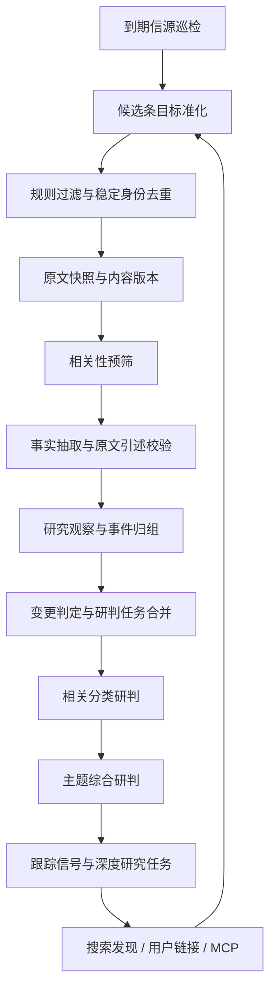

# 小察数据源配置与持续研究技术方案

日期：2026-10-28（北京时间）。状态：分阶段实施中。本文与配套信源清单是目标设计；实际交付以当前代码和下文“当前实现状态”为准。

## 1. 目标与交付边界

在小察 `market-intel` 的 `/app/market-intel` 工作台增加专属“数据源配置”入口，用稳定的信源巡检持续发现资料，复用现有原文提取、引述校验、观察保存、分类研判、主题研判能力。自由话题研究、用户链接提交、MCP 和固定信源进入同一证据链。

第一批直接复用当前资讯项目的资讯信源，不包含其 AI 模型排行榜评测源。保留 UniEmployee 的 Python / FastAPI / Vue / PostgreSQL 技术栈，不移植 Node.js 和 pg-boss；借鉴采集器接口、游标、内容版本、事件聚合、回执与预算控制机制。

本方案覆盖一键启动、批次进度、稳定性、唯一性、质量门禁及业务闭环目标；配套 44 源清单仍是导入提案，不会在启动时播种或自动启用。当前代码实现到单源配置/试抓、增量采集、持久批次与基础进度，未启用定时巡检，也不会因导入或试抓自动调用模型。

## 当前实现状态（2026-10-28）

- 已实现：租户隔离的 RSS 来源 CRUD、版本并发校验、配置字段白名单、清单 dry-run 与幂等草稿导入；44 源按 37/7 计划状态导入但全部默认停用。
- 已实现：RSS/Atom 解析、条件请求、逐跳公网 DNS/IP 校验、单域名并发 1、全局抓取并发 4、2 MB 响应限制、试抓记录、首次回采（最多 500 条/源；无发布日期的条目不纳入时间窗）、稳定文档身份与不可变内容版本。
- 已实现：单源运行和持久采集批次、request_id/活动范围幂等、每批候选条数预算、暂停/继续/停止/仅重试失败来源、基础统计与页面轮询；批次可只抓文章原文并版本化而不触发模型；多主题来源要求先选主题；原文引述匹配通过后写入 `source_attributed`，独立佐证仍明确未完成。
- 尚未实现：固定频率的来源巡检、租约与 fencing token、多级域名/租户预算、公平调度与高低水位背压、共享来源任务完整引用计数、失败文章级重试、真正的历史回采、正文修订后的主题分析重跑、待核验审核决策 UI、claim/事件归组/研判合并与研究到业务行动反馈。政策来源覆盖仍不足。
- 清单导入不会抓取外网；只有管理员手动试抓或启动批次才发起 RSS 请求。批次中的文章可进入现有市场 intake 与模型流程，需先由管理员显式启用来源。

## 2. 源码现状与可复用能力

| 模块 | 已有能力 | 本方案中的用途 |
|---|---|---|
| `backend/app/market_intake.py` | `fetch → extract → save → category → topic` 检查点；公开 URL 校验；JSON/Pydantic 校验；原文 quote 匹配；按租户主题串行、总并发 2 | 单篇处理的基础，逐步拆分阶段，兼容原接口 |
| `backend/app/market_research.py` | 观察、URL/外部 ID 去重、软删除、唯一分类、版本研判、引用与 freshness 校验 | 继续作为研究事实和结论的业务层 |
| `backend/app/tools/market_research.py` | 对话研究结果保存工具 | 转入统一证据处理和后处理队列 |
| `backend/app/mcp_servers/market_research.py` | 外部智能体查询、保存观察和研判 | 继续使用相同租户、去重和引用约束 |
| `backend/app/automations.py` / `scheduler.py` | cron/event、执行记录、身份验证、到期任务认领 | 承载巡检与批次研究调度，不让模型决定采集阶段是否完成 |
| `frontend/src/views/agent/market-intel/MarketIntelWorkbench.vue` | 配置菜单、观察、主题看板、任务入口 | 加入“数据源配置”及运行状态入口 |

当前链接链路已经可恢复；自由话题和定时 Agent 研究仍依赖工具执行来形成观察。现有单篇任务可能继续更新分类与主题；批量导入时需合并研判。当前正文读取支持 HTML/文本，PDF、强渲染和登录页面需另接适配器。URL 去重尚不能覆盖跨来源事件及正文修订。

现有观察等数据使用 conversations 业务库；新增采集业务表先放同库，通过 `app/db.py` 访问，不新增业务 database。正式部署使用 PostgreSQL；SQLite 继续仅用于隔离测试。表结构增量升级放启动初始化，避免继续扩大请求内建表自检。

## 3. 首批信源基线

配套文件：[market-intel-initial-sources-2026-10-28.json](./market-intel-initial-sources-2026-10-28.json)。

基线来自本地资讯项目的 RSS 配置文件快照，记录文件 SHA-256 与仓库 HEAD。共 44 个 RSS：原配置期望启用 37 个、停用 7 个。只读连接原项目运行库时认证失败，因此不能声称清单等于运行库当前状态；本次也未重新验证外网可达性。Git HEAD 只说明仓库基点，准确配置以文件哈希为准。

清单保留源 ID、名称、feed、分级、一手标记、频率、标签、参与方式和首次回采限制；`origin.config` 保留可追溯原配置。原源 ID 用作迁移身份，界面不展示原项目名称或 Logo。`feedUrl` 等字段转换为 Python 端命名；不得静默忽略未支持配置。

首批均为 RSS，无须极致了、SocialData 等采集服务密钥。不得复制原项目 `.env`、密钥、数据库、文章、模型结果、游标或运行历史。全文展示/分发继续保持清单中的关闭状态。

### 3.1 主题路由

- 大多数源候选主题为 `ai-frontier`；机器人专业源候选主题为 `embodied-intelligence`。
- DeepMind、NVIDIA Technical Blog、arXiv cs.CV 可进入两个主题的相关性判断；这是建议映射，导入预览允许管理员修改。
- 每条观察仍只能属于现有主题下唯一 `category_id`，不能把来源标签直接写成观察分类。一个文档可在不同主题形成不同观察，但共享文档读取与可复用提取结果；分析输入含主题和分类规则版本，不能跨主题误用结果。
- Nature、Science、STAT 等广泛科学/医药源需要严格相关性过滤；纯医药材料不自动变成 AI 研究依据。不因导入信源新增主题或改动现有分类体系。
- 本批不构成政策主题的稳定一手覆盖。政策主题标记“信源覆盖不足”，后续单独配置监管部门、政策公告与标准来源。

### 3.2 导入与启用

导入先 dry-run，展示新增、复用、配置冲突、停用源及主题建议。采用 `(tenant_id, import_namespace, legacy_source_id)` 幂等映射，并以规范化 feed 身份检查同租户重复来源。原始导入哈希与当前配置分开保存；重复导入不覆盖管理员修改。

`desired_enabled` 表示沿用原配置的目标状态；导入落库时统一为草稿/停用，`activate_on_import=false`。管理员完成预览、试抓和预算设置后，可一键启用原计划启用且试抓通过的源；原停用的 7 个源保留停用，必须单独修复再启用。清单不是已注册的生产 seed，不应在应用启动时无条件播种全部租户。

首次回采按清单逐源限制执行；历史文章用原文时间归档。首次导入不批量发预警，不把历史文章计作当天的新变化。停用不删除历史文档、观察或研判。

## 4. 小察工作台入口与交互

### 4.1 入口

在工作台右上角“配置”菜单最前增加“数据源配置”，文案“RSS、网页与接口来源，采集频率及运行状态”。保留已有技能、连接器、采集任务入口。主题看板沿用同一入口，进入时带当前 topic 筛选。

新增前端路由 `/app/market-intel/sources`，路由名 `market-intel-sources`，组件 `MarketIntelSources.vue`；注册在 `frontend/src/router/index.js`。数据源入口指向专属页面，通用连接器页仍用于 MCP，自动化页仍用于研究/发布任务。

第一版入口按现有 `auth.isAdmin` 展示；服务端仍必须验证当前租户管理权限。管理对象始终限定当前租户，不能依靠隐藏按钮完成授权。已分配小察的普通用户可以在工作台看到脱敏运行摘要，不可改配置、导入、试抓、手动采集或读取凭据。

### 4.2 数据源页

顶部提供新增来源、导入首批信源、批量启停、主题/类型/健康筛选。列表字段：名称、类型、主题、分级、一手来源、状态、间隔、最后成功、下次采集、本轮发现/新增/重复、积压和错误。RSS 首期可编辑；未实现类型明确显示“暂未支持”，不能保存后假装可运行。

编辑面板包含 feed URL、候选主题、分类提示（非固定分类）、间隔、首次回采条数/月份、摘要是否正文、订阅分类允许/拒绝规则、噪声过滤与 URL 规则。高级配置按类型白名单验证，服务端返回字段错误。凭据只接受后端 credential reference，不把 token 放进 URL 或普通 config JSON。

每行操作：试抓、立即采集、编辑、启停、运行记录。试抓返回前若干候选的标题、链接、时间、正文状态和解析诊断，不入观察库、不调 LLM；仍记录网络开销，未来付费试抓也走预算与回执。

“立即采集”返回 202 和 job/run ID；页面轮询状态，关闭页面不取消任务。运行详情按阶段显示发现、过滤、新增、变更、重复、正文成功、待分析、入库观察、事件、待研判、失败/重试；已读到文章但主题研判失败时展示部分完成，不显示整条链路全部成功。

### 4.3 一键启动：建立可追溯的采集批次

工作台主操作区增加“一键获取数据”，旁边提供“采集进度”；数据源页提供“获取已启用来源”和“获取选中来源”。主题页面默认只采集关联当前主题的来源，工作台首页默认本租户全部已启用、具备合法配置的来源。管理员可启动；普通已分配用户只读脱敏进度。首批最多纳入 37 个计划启用源，实际以启动时已启用且通过准入检查的集合为准，7 个停用源不会被自动开启。

点击按钮由服务端创建持久 batch，立即返回 202 和 batch_id，页面跳转进度页。批次冻结来源 ID、配置版本、范围、时间窗、回采策略、预算上限和操作者；预检查不通过的来源逐项列出原因，不 silently 忽略，也不为无效配置发起付费任务。全部不满足启动条件时返回可理解的原因，不创建“成功的空批次”。

一次点击只启动本轮增量获取，不等同开启永久值守；定时巡检启用状态单独配置。首次回采按既有条数/月数限制进行，再次点击默认增量；“历史回采”是明确独立操作，须展示预计上限和成本。界面预先显示本次范围和限额，正常启动无需逐源重复确认。

前端生成 request_id，服务端以租户＋request_id 做持久幂等；相同范围已有活动批次时返回其 ID 或关联已有任务。部分范围重叠则创建 membership 指向已有源任务，不重复发网络请求。手动批次与定时任务共用源级认领、游标和限流，不形成两套抓取器；同租户不同范围互不越权。

提供暂停、继续、停止投递、仅重试失败项和查看历史批次。暂停只停止新认领，已发请求在正常响应/超时后保存检查点；继续不丢进度。停止不回滚已形成的文档/观察，也不取消被其他批次共享的任务；取消尚未启动任务时按 membership/引用归属判定，不破坏定时任务。批次内来源在运行中被管理员停用时不再认领该来源，记录 skipped_disabled；已经抓到的资料按版本继续保存，是否继续分析由显式的暂停分析操作决定。

### 4.4 采集进度专页

新增 `/app/market-intel/collection`（批次历史）和 `/app/market-intel/collection/:batchId`（本轮详情），组件建议为 `MarketIntelCollectionRuns.vue` / `MarketIntelCollectionProgress.vue`。页首常驻批次范围、启动人、启动时间、预算状态、最近心跳与最后刷新时间。关闭、刷新、换浏览器或重启服务后按 batch_id 恢复，不能把浏览器连接当执行器。

页面分四部分：

1. **来源进度**：固定的来源总数，排队、运行、等待重试、成功、跳过、最终失败及最近错误；逐源展示已发现条目、正文可读量和下一次重试时间。
2. **资料处理队列**：待抓正文、正文处理中、待预筛、待提取、质量待复核、已形成观察、去重、无关、失败、等待预算；可按来源/阶段/错误筛选并查看可追溯记录。
3. **研判更新**：受影响分类数、待合并、运行中、完成、未更新原因与主题报告版本。明确“资料获取完成，研判仍处理中”或“获取部分失败，报告覆盖不完整”。
4. **质量与运行**：一手/转载/独立佐证分布、原文可读率、引用校验状态、冲突与待复核数、队列最老等待时间、模型用量和熔断原因。

首次实现用有界轮询（建议活动批次 2–5 秒、后台页降频、终态停止）；大规模再增加 SSE，只推送事件/版本号，重连仍从数据库汇总恢复。列表分页、事件有序号、统计响应带 as_of 和 version，拒绝旧响应覆盖新状态。统计异常或离线显示“暂未更新”，不伪造零积压。

#### 进度口径

- 来源进度 = 已终结来源数 / 本批固定来源数。终结含成功、明确跳过、耗尽重试后的最终失败；100% 只表示这一阶段已处理完，不表示全部成功，旁边始终显示失败/跳过数量。
- 发现条数在抓取过程中会增长，资料阶段先展示“已处理 N / 当前已发现 M，仍在发现”；只有全部来源发现结束后才冻结发现分母。资料涉及多主题任务时，另列文档数、分析任务数和观察数，不混用。
- 每阶段任务状态互斥：queued / running / waiting_retry / waiting_budget / succeeded / rejected / skipped / failed / cancelled；waiting 不是 failed，也不是已完成。attempt 与业务 task 分开记录，重试不增加资料总数。
- 唯一文档、当前版本、来源发现、观察、事件分别计数；相同文档被两个源发现时 found 可以为 2，unique_document 为 1。引用同一公告的五篇转载不展示为五份独立验证。
- 不拼一个来源、资料、研判混合的虚假总百分比；分别展示三个阶段和业务结果。source_fetch_finished_at 与 pipeline_finished_at 分开保存，尚有待复核/等待任务时不能显示全链路 done。
- 批次状态：queued / running / paused / waiting / completed / completed_with_issues / failed / cancelled。只有全部批次任务与其研判版本依赖已终结才结束全链路；被新证据延后的研判显示 superseded_by 新任务并追踪到新版本，不能静默丢失依赖。完成但存在明确失败/质量拒绝时解释 issues；质量拒绝与技术失败分别统计。

### 4.5 首页与队列的连接

小察首页增加最近采集摘要和活动批次入口。观察详情能回溯批次、源、原文版本、事实引述、质量结论和关联研判。队列中的“已入库”只表示相应层已持久化：原始资料、研究观察、可用证据、研判完成分别展示，不能让用户把它们理解成同一件事。

## 5. 采集和分析链路

### 5.1 发现和读取

实现统一 `SourceAdapter.fetch(source, cursor) -> FetchResult`，输出候选和建议新游标。候选包含稳定 external_id、原始/规范 URL、标题、发布时间、摘要、可选正文、来源；每源失败不能中断其他源。RSS 支持 RSS/Atom、ETag/Last-Modified、304、正文/摘要区分、图片链接处理；仅在条目与处理任务持久化成功后推进成功游标。

先解析、过滤、按源限制批次，再创建单篇任务。正文优先使用合格 feed 内容，否则复用 `fetch_document` 的公开地址校验，逐步增加专业正文提取器；动态网页读取作为受预算控制的兜底。保留逐跳 DNS、公网 IP、TLS、重定向和响应大小限制，不因引入第三方抓取库绕开这些约束。PDF/登录/验证码/受限网页明确失败或进入待人工处理，不能用搜索摘要冒充读过原文。

### 5.2 身份与版本

文档身份以租户内规范 URL/来源稳定 ID 去重，来源发现记录单独保存。不同来源发现同一原文不覆盖它的标题和正文。内容指纹来自清理后的标题与正文/摘要，去除无意义空白和站点模板波动；变化则追加不可变版本。已见版本不反复分析。记录发布时间、发现时间、抓取时间、事件时间；政策另记录生效日期，不能混用。

来源发布超过 48 小时才首次发现的内容，或明确 backfill 的历史材料，保留可研究价值但不算当天新增/紧急预警。当前新增和历史回采分队列优先级。页面公开展示与后端分析读取权限分别处理。

### 5.3 LLM 阶段

1. 相关性预筛：PASS / BLOCK / UNKNOWN。明显无关存入原始资料诊断，不进入观察；资料不够时 UNKNOWN 进入正文补全或待核验，不能直接提高证据等级。
2. 结构提取：复用现有 `Extracted` 与 Fact/quote 校验，保留事实、判断、不确定性、跟踪信号、唯一分类及结构化维度。各阶段分别记录模型、提示词版本、输入版本、响应、耗时、token、错误。
3. 质量和新颖性：判断来源身份、是否转载、是否新增事实、是否改变研究问题。重要性、相关性、独立证据和热度分别保存，不压成一个无法解释的分数。不直接沿用资讯项目两次评分或原行业门槛；先人工标注样本再校准。
4. 保存观察：校验主题分类、来源、引用、租户与权限；新版本通过验证后再更新当前投影。已有 quote 校验保证“原文确实这样说”，不能被解释为“事实已独立核实”。

默认继续使用小察 catalog 中配置的模型；后续可以按预筛/提取/归组/研判指定模型角色，默认回退小察模型。配置必须落运行 catalog；修改员工 YAML 不能被当作已有库已生效，也不能覆盖管理员人设/工具绑定。

### 5.4 事件与独立证据

先按 URL、发布机构、产品、动作、时间筛候选，再用向量召回或可用的词面召回缩小范围，最后让 LLM 判断同一次发生、同一事件进展、无关、多主题综述。低置信合并待复核；人工归组锁定。

观察保留原唯一分类；事件与观察多对多，通过 membership 追溯。记录发布者与原始发布家族，转载不增加独立验证数量。事件关注度按独立参与来源和时间衰减展示，和证据质量、商业价值分开；不以文章数代替行业成熟度或商业化进展。

### 5.5 研判合并与变化门槛

单篇任务的默认完成点改为“观察入库、事件处理完成”；随后仅标脏相关分类，投递合并研判。原手动链接接口可继续请求等待分类/主题完成，但阶段状态应允许分别展示，避免破坏现有前端契约。

同租户同主题的研判任务做去抖合并，等待窗口作为可配置参数（建议从 5–15 分钟试运行，而非已校准固定标准）。关键政策生效、重要冲突证据等可走优先任务。变化门槛包括新指标、部署阶段改变、约束变化、原结论被反证；仅重复报道不生成新结论版本。

按受影响分类批量更新，然后从已保存的有效分类研判更新主题；保留现有 scope signature、有效引用、generation_key 和 freshness 校验。研判前后范围发生变化则重新排队，不能用旧输入标记 current。每版保存真实输入版本及实际引用，呈现新增、维持、上调、下调或撤回的依据。

替换 `_pack()` 当前按长度截断的输入策略：选择新增、关键历史、冲突证据；大批次分批合成。保存纳入数/总数与未覆盖范围，不声称全库逐条阅读。

### 5.6 多来源稳定性：受控投递和背压

一键启动是批次入队，不是同时对 37 个来源开启无上限抓取。服务端采用全局、租户、域名、服务商四级并发/速率预算；多个 arXiv/Nature feed 按实际目标域名共享限制，重定向后的目标域名也占配额。租户按轮转/配额公平领取，单一高产源不能占满 worker。

容量分别配置抓取、正文、模型、研判四个池。建议试运行从总抓取并发 4、单域名 1、单主题研判 1 开始，模型并发取服务商限额、预算和当前容量的最小值；这些是启动试验参数，必须用延迟、429、内存和成本实测调整，不能当作已验证吞吐保证。

- 投递按小批分页并限制每源条数、总候选数、单次响应大小、累计字节和处理时限，避免高产 feed 及长文耗尽资源。
- 为待处理文档/模型队列设置高低水位，超过高水位暂停发现或仅落盘，不继续无限创建分析任务；低于低水位再恢复。高低水位依据容量配置，界面展示 waiting_capacity 和最老等待时间。
- 每源独立 timeout/retry，429 遵守 Retry-After，5xx/网络错误退避加抖动；连续故障按域名/服务熔断，冷却后单任务半开试探。解析错误、无权限、永久下线单独处置，不无限重试。
- 批次设置可配置总时限与重试上限；超时的剩余任务明确结束或转待处理，不永久显示 running。单源失败允许其他源继续，完成后仅重跑失败项。
- 认领使用持久租约和 fencing token；旧 worker 租约失效后的写入被拒绝，游标更新带版本 CAS，避免两个进程覆盖源进度。阶段结果和后续 outbox 同事务，重复消息按业务唯一键消费。
- 配置快照只用于本批追溯，后续批次使用新版本；修改权限/凭据、撤销来源与租户配额立即影响新认领，不能借旧快照绕过当前授权。

### 5.7 唯一性：从发现到报告的六层约束

| 层 | 唯一/幂等身份 | 处理原则 |
|---|---|---|
| 启动请求 | tenant_id＋request_id；活动范围匹配 | 连点返回已有批次，不重复收费任务 |
| 来源执行 | tenant/source＋采集代次或有效活动认领 | 手动/定时共享任务，游标 CAS |
| 文档身份 | tenant＋canonical identity，来源稳定 external_id 建别名映射 | 先唯一约束再业务复查，处理并发竞争 |
| 文档版本 | document_id＋content_hash | 内容相同复用；实质修订保留版本及更正关系 |
| 阶段与观察 | tenant＋version＋topic＋stage＋规则/模型指纹；观察修订历史 | 阶段可复用；同文不同主题不重复抓正文，不误复用主题判断 |
| 事件与研判 | 事件关系幂等＋人工锁定；scope/version 指纹＋generation key | 转载保留出处不增加独立证据；无新结论不重复发布 |

URL 规范化仅去已知跟踪参数，保留决定正文的查询参数；锚点是否属于文章身份由源配置决定。canonical 标签和跳转目标必须经过 URL 校验且不能任意信任；跨域 canonical 先做别名候选。短链接/长链接/AMP/镜像由稳定 ID、重定向与内容指纹辅助识别。

正文哈希相同可以复用技术提取，但仍保留各发布者及发现记录；近似哈希/向量只能提议疑似重复，不能自动删除不同时间或不同含义的证据。标题相同不等于同一事件。唯一约束全部含租户边界，回收站内容不被自动重建或恢复。

### 5.8 权威性和准确性：先准入，再进入研判

高质量证据是进入研判的条件，不能以“抓取成功”或“模型输出格式正确”替代。权威性按发布主体和主张类型判断：厂商是其新品发布的一手来源，但其“行业第一”的比较主张仍需独立证据。沿用源 tier 作为初始标签，不能仅凭配置 T1 就自动判定所有内容可信。

建立分开的质量状态：unverified / source_attributed / corroborated / disputed / rejected / needs_review，并记录每一状态的证据、规则和审核者。其中 source_attributed 表示“已读原文且可归属发布方”，corroborated 才表示关键主张有独立证据；状态由服务端校验与可追溯审核形成，不能由模型自报 confidence 直接升级。

| 门禁 | 校验内容 | 未通过的处理 |
|---|---|---|
| Q0 来源准入 | 发布机构、官方域名/账号对应、原始/转载身份、配置来源、更新情况和试抓 | 标记未核验、停用或只进入候选池；保留管理员核验记录 |
| Q1 原文完整性 | 正文可读、页面确为目标文章、发布日期依据、截断/附件遗漏、原文快照与哈希 | 待补正文或降级；不能用搜索摘要代替完整阅读 |
| Q2 事实准确性 | 逐字引述定位；主体、数值、单位、统计时间/范围；发生/计划/目标；政策发布/生效日期 | 不合格事实拒绝入证据层，其他合格事实可独立保存；禁止模型填造缺项 |
| Q3 独立核验 | 主张级 provenance；引用链原始发布方；至少两份独立依据或明确单一自述边界 | 单源可作带归属的观察；重大/有争议主张进入复核，不升级确定性 |
| Q4 研判可用 | 相关性、新颖性、冲突/撤稿、更正、人工状态、时效、实际输入范围 | 有问题证据隔离或带边界使用；阻止无依据的高置信结论/预警 |

quote 字符匹配只证明原文这样写，不验证作者是否说真话；报道数不等于独立核验数。日期不可得则保留未知，不能把 fetched_at 补成 published_at；单位换算、同比/环比和指标口径可用确定性规则验证，无法校验时列明限制。

保存主张级 claim（文本、原文 quote/位置、文档版本、主体、时间、数值单位、主张性质、来源家族、独立佐证/反证）。任何撤稿、更正、归组纠错和人工否定须反向标脏依赖的分类/主题报告，保留历史并提示受影响结论，不能只更新观察列表。

增加“待核验”工作台：高影响单源主张、事实冲突、重大数值异常、来源身份不明、政策时点和低置信事件合并优先审核；抽样检查其余资料。对话/MCP/手工录入统一保留 method 与质量状态，没有经过原文读取和 quote 校验的记录不得伪装成流水线已核验资料。未核验材料可以保留在观察库，但只有满足相应规则的主张进入正式研判证据集合。

重要报告遇到来源抓取缺口时展示覆盖不足，不能用少量成功源代表全行业；关键主题无足够合格依据时保持待更新/低置信，不为完成批次而生成报告。准入和阈值用人工样本校准，不承诺自动抓取能保证所有外部事实真实。

## 6. 数据模型（拟新增，非已存在）

| 表 | 关键字段和约束 |
|---|---|
| `market_collection_batches` / `market_collection_members` | tenant、request_id、范围及配置快照、预算、状态、来源分母、阶段完成时间；批次与已有源/文档/研判任务的关联与终态依赖；租户请求唯一 |
| `market_claims` / `market_claim_evidence` | 主张、逐字引述与位置、原文版本、数值口径、主张性质、证据/反证及独立发布家族，和观察/研判引用的依赖 |
| `market_quality_reviews` | tenant、来源/文档/主张、质量状态、问题、证据、审查人、规则版本和审查历史 |
| `market_pipeline_events` | batch/task、递增事件序号、时间、状态变化、脱敏详情；持久进度与断线恢复 |
| `market_sources` | id、tenant_id、name、kind、config_json、candidate_topics_json、tier、first_party、publisher_family_id、participation_mode、enabled、interval_minutes、next_fetch_at、cursor_json、health、config_version、credential_ref、导入身份/哈希、创建修改审计；租户＋导入身份唯一 |
| `market_fetch_runs` | tenant/source、trigger、status、输入/输出游标、各阶段计数、错误、开始结束、lease_owner/expires_at；手动请求幂等键 |
| `market_documents` | tenant、canonical_identity、canonical_url、current_version_id、首次发现与时间字段；租户内身份唯一 |
| `market_document_versions` | tenant/document、content_hash、清洗文本、受限原文快照位置、抓取时间、提取器版本、截断标记；document＋hash 唯一 |
| `market_source_discoveries` | tenant/source/document、external_id、原链接、首次/最后发现；同源稳定 ID 幂等 |
| `market_analysis_runs` | 阶段、输入文档/版本、主题规则版本、模型、prompt_version、身份哈希、状态、响应/校验结果、usage、回执、租约、retry_at |
| `market_events` / `market_event_observations` | tenant、事件事实框、状态；观察关联、关系、独立发布家族、人工锁定与历史审计 |
| `market_judgement_jobs` | tenant/topic、dirty 分类及版本、原因、due_at、租约、重试；同范围合并，不吞掉运行中新到的 dirty 标记 |

现有 observations 增量关联 document_version 与提取记录；现有 judgements 继续保存版本，补输入范围指纹和变更说明。空关联兼容存量。观察修订追加历史，人工分类/删除状态优先；同 URL 更新不能静默覆盖人工内容或恢复回收站。跨租户不复用正文/模型响应，租户内跨主题复用只限身份完全一致的可共享阶段。

正文按租户受限保存，不暴露给列表 API；配置、正文、回执、研判分别定义保留策略，研判引用的版本不能先清理。新增表不复制业务库。

## 7. API 契约（拟新增）

统一前缀 `/api/market-research`，沿用 auth context 与小察分配检查。

| 接口 | 行为 |
|---|---|
| `GET /sources`、`GET /sources/{id}` | 分页/主题/健康筛选，配置脱敏 |
| `POST /sources`、`PATCH /sources/{id}` | 管理员新增/编辑/启停，校验类型配置；带 config_version 做并发修改校验 |
| `POST /sources/import/preview` | 接收受支持版本清单，返回新增/复用/冲突，不写生产来源 |
| `POST /sources/import` | 按 preview token/版本幂等导入为草稿，不自动抓取 |
| `POST /sources/{id}/preview` | 试抓有限候选，无 LLM 和观察入库；记录运行成本 |
| `POST /sources/{id}/collect` | 202＋持久 run ID，按源合并重复触发 |
| `GET /sources/{id}/runs`、`GET /source-runs/{run_id}` | 阶段、计数、结果和错误，全部校验租户 |
| `POST /source-runs/{run_id}/retry` | 从失败检查点恢复；完成任务不重复执行 |
| `GET /sources/summary` | 脱敏采集与分析积压计数，授权用户可读 |

新增批次接口（管理员写、已分配小察用户按租户权限读取）：

| 接口 | 行为 |
|---|---|
| `POST /collection-batches` | 范围、增量/回采模式、request_id、限额；原子创建批次，202 返回 batch_id/已有活动批次与被排除源 |
| `GET /collection-batches`、`GET /collection-batches/{id}` | 分页历史和一致性阶段统计，返回 as_of/version/阶段分母是否冻结 |
| `GET /collection-batches/{id}/tasks`、`GET /collection-batches/{id}/events` | 分页队列、阶段筛选、last_sequence 后事件，权限与详情脱敏 |
| `POST /collection-batches/{id}/pause`、`/resume`、`/stop`、`/retry-failed` | 幂等状态转换，返回受影响任务数与不可取消的共享任务；不重复创建新观察 |
| `GET /quality-reviews`、`POST /quality-reviews/{id}/decision` | 待核验列表与带原因/证据的审核；审核写权限和小察管理权限单独检查 |

静态 `/sources/import/*`、`/sources/summary` 路由在动态 `/{id}` 前声明。URL/JSON Schema 错误返回 422，无权限 403，跨租户对象统一 404，版本冲突 409。列表和日志不返回原始凭据、带鉴权查询参数的 URL 或完整异常响应。

## 8. 调度、回执和恢复

沿用 scheduler 生命周期新增固定巡检 tick，按 due sources 创建采集任务，不为每个 feed 启动完整 Agent 会话。抓取、单篇分析与研判分阶段限流；同一源避免并发游标竞争，同租户主题研判串行，历史任务低优先级。

PostgreSQL 通过事务认领（行锁或 CAS）与租约、心跳控制多进程执行；进程内 asyncio 锁保留为优化，不作为持久互斥保证。SQLite 测试分支采用条件更新模拟认领。认领原子地写入任务与游标，业务写入和下一阶段投递同事务或用 outbox；重试保证业务效果幂等。

模型回执身份包括租户、阶段、文档版本、主题/规则、模型、提示词与参数哈希。成功输出先落回执再落业务结果；重试复用已完成结果。发送后超时归为结果未知，不能宣称可以保证供应商只计费一次；支持上游幂等键时使用，不能支持时限制自动重发并可人工核对。

来源网络错误、429、5xx 指数退避加抖动；正文不可读、永久拒绝与模型结构错误分别处理。预算耗尽标记 waiting_budget，不算来源永久故障；不可恢复或超过限制进入待处理队列。模型和采集按租户/服务/分钟小时日设置上限，试抓、浏览器、搜索也计入。中断后过期租约自动恢复；源游标不因分析失败倒退，后续处理通过已持久化文档任务继续。

## 9. 实施拆分与代码位置

### 批次一：单源闭环和配置入口

交付数据源配置入口、首批清单导入、RSS 试抓、原文版本、基础质量状态、逐源运行记录和现有 intake 接入。并行补齐业务唯一约束、持久任务认领、成功阶段复用和基本预算保护。先用 1–3 个确认过的来源验证从发现到观察的完整链路，不开放无保护的全源启动。

### 批次二：一键启动和可恢复进度页

交付批次表/API、一键启动、进度专页、持久事件、暂停/继续/停止/仅重试失败、域名限流、租约 fencing、退避熔断、背压和按主题合并研判。完成并发重复点击、手动与定时重叠、重启恢复、部分失败和预算耗尽测试后，先开放约 10 源，再扩至本批可用的 37 源；分组数量是验证批次建议，扩大范围以实际指标和验收通过为条件。

### 批次三：权威证据和事件闭环

补齐来源身份核验、claim 级证据链、独立发布家族、事件关系与人工复核、待核验页、撤稿更正传播及实际证据选择。上线前已有的 quote 校验、来源归属与未核验标记不能延期到这一批。借助人工标注集校准相关性、重复判定、事实抽取和研判可用性；界面分开展示覆盖度、关注度与可信度。

### 批次四：研究到业务行动

建立“研究问题—证据—结论变化—建议行动—负责人—结果反馈—再研究”的任务链，提供待办/审批关联、观察信号的到期复查、行动效果与判断偏差记录。扩充政策权威源和确有需求的 JSON/网页/PDF/动态页面/公众号适配。优先补覆盖缺口，不单纯增加源数量。

新增代码建议：`backend/app/market_sources/` 实现 adapter/import/repository/collector；`backend/app/market_pipeline/` 实现 batch/queue/quality/receipt/judgement 编排；`backend/app/routes/market_sources.py` 与现有路由统一注册。新增来源页、批次列表/进度页和质量审核组件，修改 `MarketIntelWorkbench.vue`、`frontend/src/router/index.js` 及启动生命周期。服务端阶段完成条件不能放到 Vue 或提示词中。

## 10. 验收与上线顺序

1. 界面：从小察配置可进入来源页，主题上下文正确，配置持久化；非管理员不能写，跨租户访问被拒绝。
2. 导入：44 条、37/7 目标启停统计与清单一致；两次导入无重复、不覆盖管理员编辑；禁用源不被启用；预览不触发 LLM。
3. RSS：覆盖 RSS/Atom、304、错误 feed、相对链接、摘要/正文、配置变更、解析失败不推进游标；运行可见 found/new/revised/duplicate 分别计数。
4. 链路：新文档形成观察，原文 quote 可定位，唯一分类合法；非相关内容可查拒绝原因；一篇读不到正文不阻断其他源。
5. 幂等：同 URL 不重复观察；正文变化生成新版本；并发重试、进程重启、任务租约过期不重复业务写入；成功模型步骤可以复用。
6. 研判：同主题批次合并；只有实际新增证据才更新；旧输入/删除引用不能保存成 current；真实输入范围和未覆盖范围可见。
7. 事件：转载不增加独立验证数，同事件后续可追溯，人工归组不会被模型覆盖；政策发布时间与生效日期分开。
8. 成本：预算暂停不标抓取永久失败；未知付费结果可审查；secret 不进入 API/日志/导入清单。
9. 一键批次：并发双击、不同请求 ID 的同范围启动、手动/定时重叠不会重复业务执行；固定来源快照可追溯，停用源不被纳入。
10. 进度：刷新、关页、断网、服务重启后恢复；重试不增分母；发现分母未固定时不显示虚假完成率；来源完成不冒充全链路成功。
11. 调控：单域名 429、某源超时、预算耗尽和队列高水位均有明确等待原因；公平调度有效；故障源不阻塞其他源，终态可单独重试。
12. 质量：来源自述不被误升级为独立证实，五篇转载仍只计原始证据家族；数字单位/计划与实现/政策日期能追溯；不合格主张不进入正式研判。
13. 更正：来源撤稿、人工纠错和证据删除会使依赖结论失效或待更新；业务行动/预警负责人能看到变化记录。

开发采用隔离 fixture 验证上述关键行为，再按仓库要求运行后端 pytest 与前端构建。联网验证使用管理员选定的少量真实来源，不在测试中调用付费服务；先试抓、再限量单源分析、再开启首批通过的来源，保留停用和队列暂停入口。文档交付本身不运行业务测试，也不声称功能验收已通过。

## 11. 参考实现与约束

- 当前项目 `packages/backend/src/sources/collect.ts`、`rss.ts`：到期采集、条件请求、候选解析和游标。
- 当前项目 `content/materials.ts`、`jobs/content.ts`：内容身份、版本、实时/历史优先级与任务路由。
- 当前项目 `providers/receipts.ts`、`events/group.ts`：付费回执、事件关系判断的可借鉴机制。
- UniEmployee `docs/guide/market-intel-data-flywheel-audit.md`：已实现链路及已知限制，实施前与当前代码重新对照。
- UniEmployee `AGENTS.md`：catalog 是运行配置来源、SQLite 仅测试、MCP/审批/租户边界与功能分支开发要求。

## 12. 业务闭环仍需补充的能力与衡量方式

只完成数据源页面和自动采集后，业务还不会自然闭环。需要定义小察究竟在支持哪项决策，并把研判结果接到人和结果上。

| 闭环环节 | 需补能力 | 交付与完成口径 |
|---|---|---|
| 研究需求 | 研究问题、目标对象、观察指标、决策时间、覆盖要求与优先级 | 每个持续研究任务有负责人和可验证问题，不只有主题名称 |
| 来源覆盖 | 主题/分类/地区/时间的权威源覆盖与采集缺口 | 展示未覆盖和长期失效来源，不能把数据总量当覆盖率 |
| 证据质量 | 原文、主张、独立佐证、待核验、冲突/更正 | 可以逐项解释结论依据，人工核验结果回流 |
| 结论变化 | 前后版本差异、触发证据、置信边界与失效条件 | 用户知道为什么变化、影响哪些已有判断 |
| 业务行动 | 建议行动、责任人、截止时间、接受/拒绝原因、审批和执行记录 | 接入既有待办/审批或先提供结构化行动单，不自动发送外部消息/下单 |
| 信号复查 | 30/90/180 天观察信号、到期检索、验证条件 | 计划是否兑现有结果记录，未验证不写“已实现” |
| 效果反馈 | 有用/误报/漏报/重复/错误判断、采用情况及行动效果 | 反馈关联原 claim、观察与研判版本，反哺源和分析规则 |
| 运营责任 | 数据管理员、分析审核人、决策负责人、问题处置时限 | 技术失败、质量待核验、业务未采纳分别有人处理 |

指标按同一时间窗与口径统计：来源检查成功率、原文可读率、积压最老时长、端到端延迟分位数、单位有效证据成本、人工抽检事实正确率、错误合并/重复率、权威来源覆盖、未核验积压、报告证据覆盖、结论被采用/纠正情况。权威来源覆盖分母来自维护的覆盖矩阵，正确率来自人工抽样标注；模型自评和未知总量不能作准确率分母。

扩源前的门槛以代表性样本和运行基线共同确定，必须有量化配置与负责人确认，不能凭空承诺固定准确率或全量实时性。各批验收分别出记录：完成项、失败项、尚未覆盖边界、是否允许扩大来源范围。该方案仍属设计文档，未执行上述功能或负载验收。
